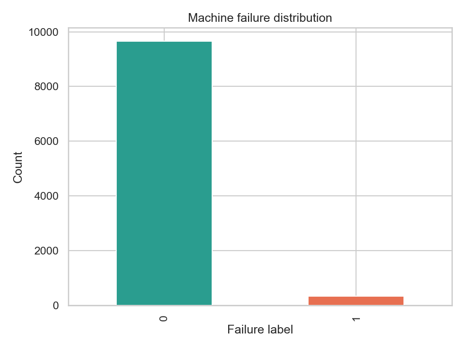
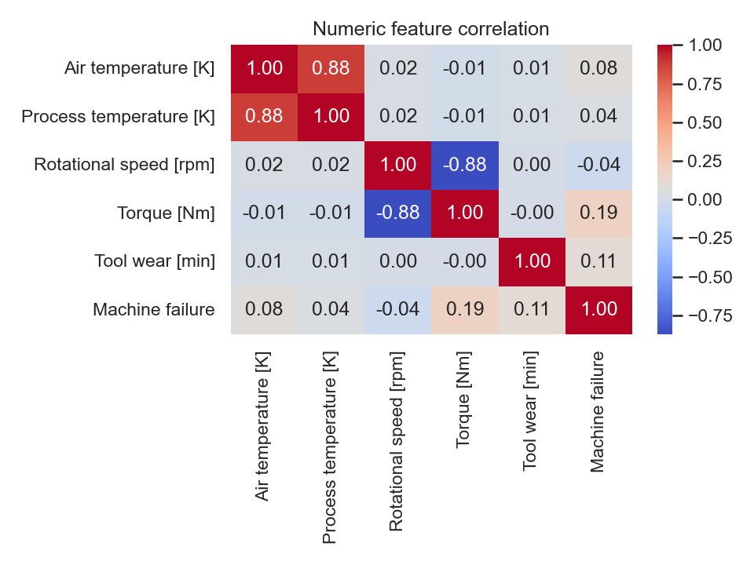
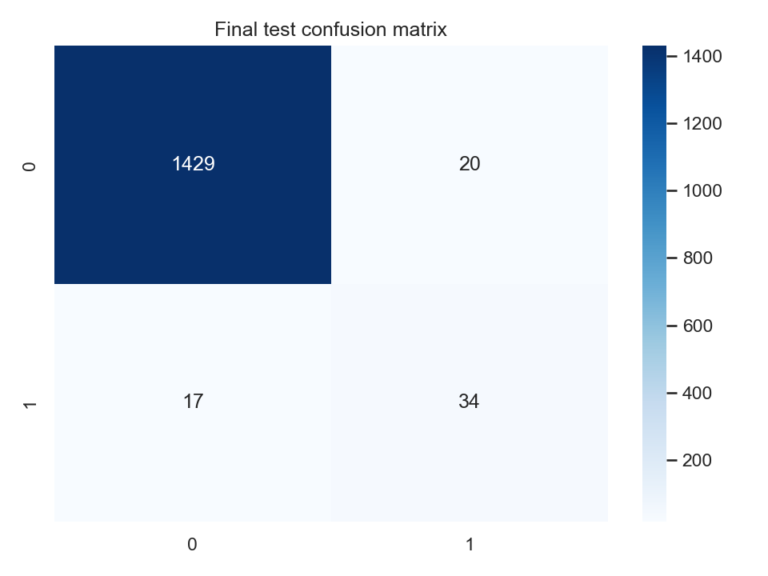
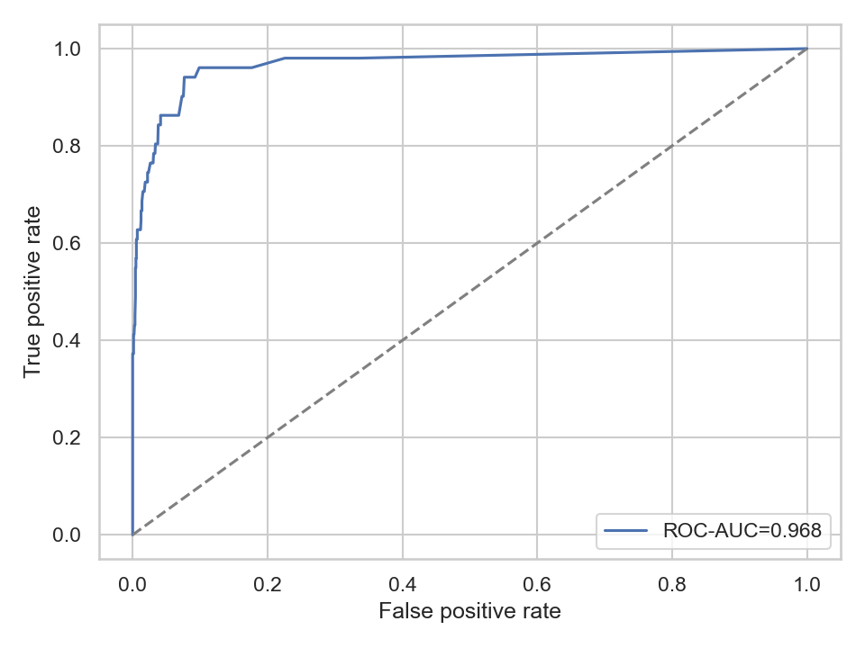
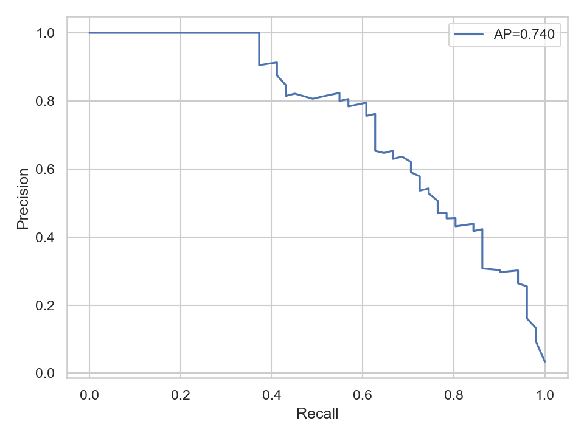
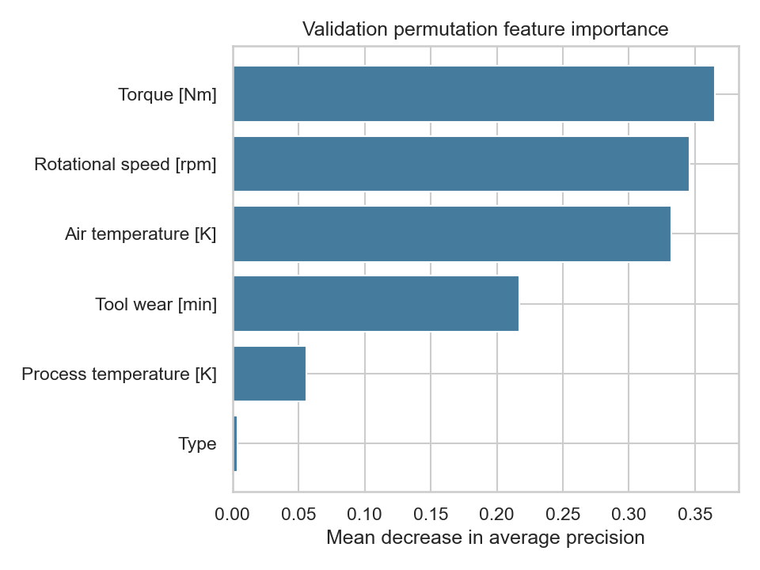

# Predictive Maintenance & Machine Failure Detection

An educational machine-learning prototype that classifies whether an industrial
machine is likely to experience a failure from its operating conditions. It is
**not** a remaining-useful-life model and does not predict the exact time until
failure.

## Problem and objectives

The project addresses binary machine-failure classification:

- `0`: no machine failure
- `1`: machine failure

The goals are to build a reproducible leakage-safe pipeline, compare three
classifiers, prioritize recall and PR-AUC for an imbalanced target, and provide
an interactive dashboard for single and batch assessments.

## Dataset

This project uses the synthetic [AI4I 2020 Predictive Maintenance
Dataset](https://archive.ics.uci.edu/dataset/601/ai4i+2020+predictive+maintenance+dataset)
from the UCI Machine Learning Repository.

Citation: Matzka, S. (2020). *AI4I 2020 Predictive Maintenance Dataset*. UCI
Machine Learning Repository. DOI: `10.24432/C5HS5C`.

The dataset is synthetic and may not represent a particular plant, sensor
calibration, operating policy, or failure process. This project is an
educational prototype, not a certified industrial safety system.

### Inputs and target

Only these six columns are used as model inputs:

1. `Type`
2. `Air temperature [K]`
3. `Process temperature [K]`
4. `Rotational speed [rpm]`
5. `Torque [Nm]`
6. `Tool wear [min]`

The target is `Machine failure`. IDs and failure-mode labels (`TWF`, `HDF`,
`PWF`, `OSF`, and `RNF`) are excluded to prevent target leakage.

## Methodology

1. Validate columns, target values, missing values, duplicates, and class distribution.
2. Split the data stratified into 70% training, 15% validation, and 15% test data using seed 42.
3. Fit imputers, one-hot encoding, and numerical scaling inside a scikit-learn
   pipeline using training data only.
4. Train Logistic Regression, Random Forest, and Extra Trees with balanced
   class weights.
5. Select the model using validation Average Precision (PR-AUC).
6. Select the alert threshold by validation F1-score only.
7. Evaluate once on the untouched test set and save metrics, classification
   report, confusion matrix, ROC, PR, and permutation-importance artifacts.

## Actual results

The current generated results are from 10,000 dataset rows with a 3.39%
failure rate.

| Model | Validation PR-AUC | Validation threshold |
|---|---:|---:|
| Random Forest | 0.6621 | 0.248 |
| Extra Trees | 0.6242 | 0.308 |
| Logistic Regression | 0.3829 | 0.915 |

Random Forest was selected. Its final held-out test results are:

| Metric | Value |
|---|---:|
| Accuracy | 0.9753 |
| Precision | 0.6296 |
| Recall | 0.6667 |
| F1-score | 0.6476 |
| ROC-AUC | 0.9685 |
| PR-AUC | 0.7403 |
| Balanced accuracy | 0.8264 |
| Specificity | 0.9862 |
| False-negative rate | 0.3333 |
| TN / FP / FN / TP | 1429 / 20 / 17 / 34 |

Permutation importance is calculated on the validation set using Average
Precision. It measures the decrease in validation PR-AUC when a feature is
permuted; it is not a causal explanation.

## Generated visualisations








The machine-readable reports are version-control ready:

- `results/metrics/model_comparison.csv`
- `results/metrics/final_metrics.csv`
- `results/metrics/classification_report.csv`
- `results/metrics/feature_importance.csv`
- `results/metrics/dataset_summary.json`

## Installation and usage on Windows

From the project root in PowerShell:

```powershell
py -3.12 -m venv .venv
.\.venv\Scripts\Activate.ps1
python -m pip install --upgrade pip
pip install -r requirements.txt
python run_pipeline.py
streamlit run app/streamlit_app.py
```

If the `streamlit` command is not on PATH, use:

```powershell
python -m streamlit run app/streamlit_app.py
```

Place the official CSV in `dataset/`. The raw dataset, generated model binary,
virtual environments, secrets, caches, and temporary files are excluded by
`.gitignore`; evaluation reports and plots are not excluded.

## Dashboard

The Streamlit dashboard provides:

- Overview metrics sourced from model metadata
- Single-machine prediction with threshold interpretation
- Batch CSV validation and downloadable predictions containing only the six
  inputs plus generated outputs
- Validation model comparison
- Final test metrics, confusion matrix, ROC, PR, and permutation-importance views

Sensor values outside the training range produce a warning. They are not
silently presented as supported operating conditions.

## Project structure

```text
dataset/          Dataset instructions and local raw CSV
src/              Loading, preprocessing, training, evaluation, prediction, EDA
app/              Streamlit dashboard
tests/            Synthetic-data and pipeline tests
models/           Selected model metadata and ignored model binary
results/          Versioned evaluation reports and plots
run_pipeline.py   Reproducible end-to-end entry point
```

## Limitations and future work

Real deployment would require validation against plant data, calibrated
probabilities, cost-sensitive alert policies, drift monitoring, sensor-quality
checks, and human safety review. Future work could add cross-validation,
calibration analysis, model monitoring, and plant-specific retraining.
